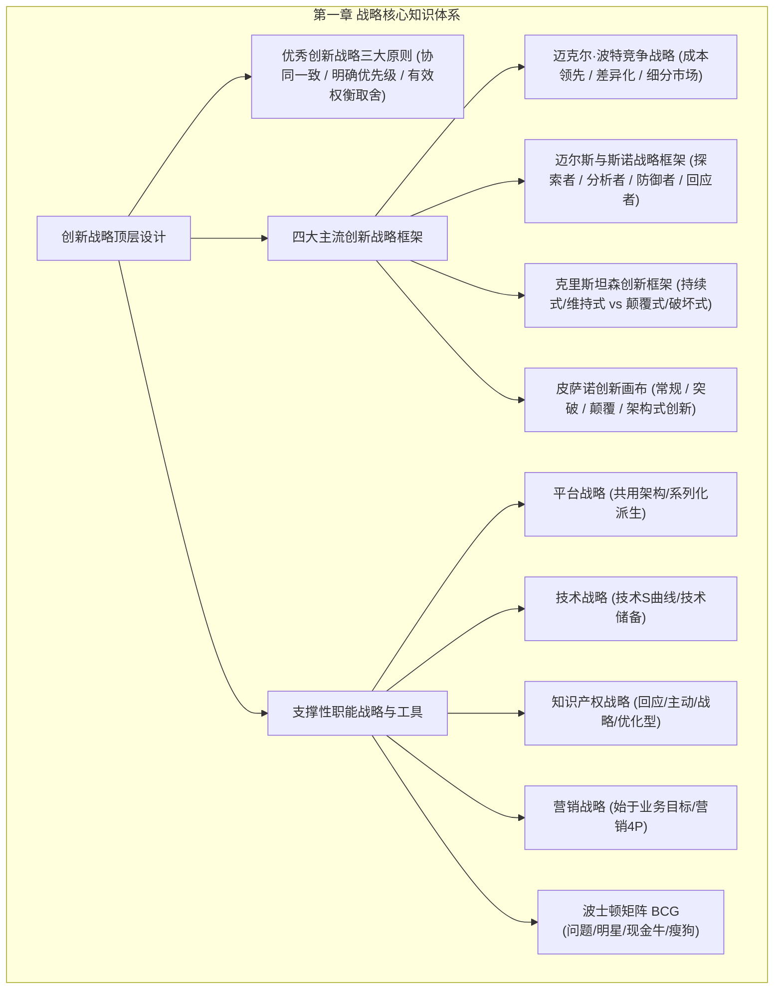

# NPDP期中模考大赛重难点讲解（上）：考情分析与第一章战略高频错题精析

## 一、期中模考考情深度分析与审题应试方法论

### 1. 模考考情数据与合格基准线
- **模考规格对标**：本次期中模考大赛共设置 **120 道单项选择题**，考查范围集中在前四个章节（第一章 战略、第二章 组合管理、第三章 产品创新流程、第四章 产品设计与开发工具）。
- **折算合格基准**：
  - 正式考试全卷为 200 题，及格线为 75%（需答对 150 题）；
  - 本次模考按同等比例换算：$120 \times 75\% = 90$ 分。取得 **90 分及以上** 即达标；
  - 阶段检验的价值在于暴露认知短板。模考中暴露出做错的每一道题，本质上都是在为正式考试消除丢分隐患。
- **海外机考高分实战验证**：近期参加海外机考的学员取得了 179 分、183 分（正确率接近 90%）的优异成绩，充分验证了当前“录播夯实基础 + 直播突破重难点 + 题库深度刷题 + 重点卷全真模考”复习路径的有效性。

### 2. 高效做题与结构化审题四大技巧
面对复杂或冗长的情境题，应遵循以下结构化步骤：
1. **粗读题干抓问句，锁定考查主体**：
   - 先看题干末尾的问句，判断考查的是宏观公司战略、业务组合、还是具体流程或工具；
   - 厘清问句主体是“公司”、“产品”、还是“特定角色”。
2. **提炼题眼关键词，逆向推导考点**：
   - 寻找题干中表述现状、问题瓶颈或期望目标的关键词（例如“大相径庭”、“共用架构”、“填补空白”、“消除浪费”）；
   - 正确答案必须能够直接“解决题干问题、达成业务目标”。
3. **“问大选大，问小选小”原则**：
   - 题干问法宏观（如整体公司战略方向），切忌选微观操作工具；
   - 题干问法微观具体（如特定敏捷交付框架），优先选择具体对应的概念（如选择 Scrum 而非宽泛的敏捷）。
4. **应试辅助排除法则**：
   - **“三同排异”法**：四个选项中若有三个属于同一理论框架（如三个属于波特框架，一个属于迈尔斯-斯诺框架），题干考查大概率聚焦波特框架，孤立选项可优先排除；
   - **不生造排除法**：在基础扎实的前提下，未曾学过或拼写生僻的概念大概率是干扰项；
   - **绝对表述排除法**：选项中出现“仅仅”、“必须”、“绝对”、“只有”等极端词汇时，80% 以上为错误选项，除非属于教材原文定义。

---

## 二、第一章“战略”核心知识框架系统串讲

### 1. 创新战略的本质与三大原则
创新战略为组织所有的创新活动提供明确的方向、目标与边界框架。一个优秀的创新战略必须满足三大基本原则：
1. **协同一致（Strategic Alignment）**：各个业务单元和创新项目必须与公司整体战略目标保持一致，形成合力；
2. **明确优先级（Clear Priorities）**：在有限的资源条件下，清晰界定不同创新项目和技术投入的先后顺序；
3. **有效权衡取舍（Trade-offs）**：敢于做出取舍，对高潜力项目果断加注资源，对失去商业价值或脱离战略轨道的项目坚决终止。

### 2. 四大主流创新战略框架精析
1. **迈克尔·波特竞争战略框架（Porter's Competitive Strategies）**：
   - **宽市场 vs 窄市场**：
     - 面向广泛受众（宽市场）：采取**成本领先战略**（规模效应、标准化、薄利多销）或**差异化战略**（人无我有、突出卓越性能与独特品质）；
     - 面向特定人群/利基赛道（窄市场）：采取**细分市场战略**（聚焦特定群体未满足的独特需求）。
   - **创新成本/开发投入成本辨析（高频考点）**：
     - **成本领先**：创新投入最低（研发投入通常占营收的 0.3%~2% 以下），重在生产制造与供应链微调优化；
     - **差异化**：创新投入较高（占营收的 2%~20%），重在拔高技术性能与打造独特壁垒；
     - **细分市场**：**创新开发投入最高**！因为必须围绕目标受众的独特需求从 0 到 1 定制开发全新产品，研发与深度调研成本极大。
2. **迈尔斯-斯诺战略框架（Miles & Snow Framework）**：
   - **以风险偏好为核心划分轴心**：
     - **探索者（Prospector，高风险偏好）**：行业开拓者，乐于承担高风险，运用新技术率先将新产品推向新市场，追求先发优势；
     - **分析者（Analyzer，适度风险偏好）**：快速跟随者与模仿者，紧盯行业标杆（探索者），待市场得到验证后迅速推出更优性价比或更高性能的产品；
     - **防御者（Defender，风险厌恶型）**：成熟市场的既得利益者，严防死守自身既有阵地，极少开发突破性新产品，主要通过产品小幅改进与衍生品维护市场蛋糕；
     - **回应者（Reactor，无固定战略）**：仅在遭受外部竞争严重威胁时被动应付，缺乏长远技术规划，“三无状态”（无技术、无计划、无成果），最不被推荐。
3. **克里斯坦森创新框架（Christensen's Innovation Framework）**：
   - **持续式/延续式创新（Sustaining Innovation）**：亦称渐进式、维持式创新。基于现有主流客户的需求，依托熟知技术逐步改良产品性能，**不创造新的市场和新的价值网络**；
   - **颠覆式/破坏式创新（Disruptive Innovation）**：亦称激进式、非持续式创新。**创造全新的市场与价值网络**，彻底改变原有产业格局（如数码相机颠覆胶卷、智能手机颠覆功能机）。
   - **颠覆式创新的“边缘切入”特征**：初期技术性能往往粗糙、不稳定，难以与主流市场成熟产品抗衡，因此先从被主流厂商忽视的低端市场或新兴边缘利基切入；伴随技术沿着“技术S曲线”高速迭代，性能一旦突破临界点，便迅速向上蚕食主流市场并最终实现颠覆。
4. **皮萨诺创新画布（Pisano's Innovation Landscape Map）**：
   - 基于“商业模式（现有 vs 全新）”与“技术能力（现有 vs 全新）”两维度划分为：
     - **常规式创新（Routine）**：现有技术 + 现有商业模式（如英特尔推出下一代更快芯片）；
     - **突破式创新（Disruptive）**：现有技术 + 全新商业模式（如拼多多电商模式）；
     - **激进式/颠覆式创新（Radical）**：全新技术 + 现有商业模式（如生物医药创新药）；
     - **架构式创新（Architectural）**：全新技术 + 全新商业模式（如数码成像结合互联网社交分享）。

### 3. 支撑整体创新的职能战略精要
1. **平台战略（Platform Strategy）**：
   - 核心抓手是**共用架构（Shared Architecture）**、核心通用技术与基础组件；
   - 优势在于大幅摊薄研发成本，支持快速、低成本派生出一系列衍生产品。
2. **知识产权战略管理四种演进类型（高频考点）**：
   - **回应型（Reactive）**：事后被动救火，开发完才考虑侵权风险，匆忙回应意外诉讼与外部索赔；
   - **主动型（Active）**：全开发流程主动识别与监控知识产权，建立专利防侵权预警，保护自身权利；
   - **战略型（Strategic）**：知识产权与公司战略保持一致，作为研发立项的法定输入，**制定明确的专利收益目标**，通过保护性授权盈利；
   - **优化型（Optimized）**：**知识产权驱动战略**，将知识产权提升为核心竞争业务，追求行业顶格优势，**为高风险知识产权诉讼进行专项投保**。
3. **营销战略与营销4P**：
   - 营销战略始于业务目标，从宏观到微观层层细化为营销组合（4P：产品 Product、价格 Price、渠道 Place、促销 Promotion）与执行计划。
4. **波士顿咨询集团增长-份额矩阵（BCG Growth-Share Matrix）**：
   - **两大评估维度**：横轴相对市场份额（High / Low），纵轴市场增长率（High / Low）；
   - **四象限特征与应对策略**：
     - **明星产品（Stars，高增长 + 高份额）**：快速成长期的中坚力量，需要追加重金投资扩大战果；
     - **现金牛产品（Cash Cows，低增长 + 高份额）**：成熟市场的绝对主导者，面临激烈竞争导致增长停滞，但源源不断产生强劲净现金流，用于反哺问题与明星产品；采取“维持战略”；
     - **问题/野猫产品（Question Marks，高增长 + 低份额）**：通常为引入期新业务，增长迅猛但份额薄弱，需审慎评估其发展潜力，有前景则追加投资，无前景则果断止损；
     - **瘦狗产品（Dogs，低增长 + 低份额）**：衰退期业务，缺乏商业吸引力，应采取舍弃、剥离或榨取剩余残值策略。

---

## 三、第一章高频错题（正确率 < 70%）逐题深度精析

### 【错题 1】波特战略框架中各战略开发投入成本比较（判断题，正确率 56%）
> **题目情境**：请对以下两个陈述的正确性进行判断：
> - 陈述一：细分市场战略强调与目标客户一起工作，调研了解客户需求。
> - 陈述二：细分市场战略开发投入比成本领先战略高，比差异化战略低。
> 
> A. 陈述一正确，陈述二错误  
> B. 陈述一错误，陈述二正确  
> C. 两个陈述都正确  
> D. 两个陈述都错误  

- **【题目考查场景与题眼】**：考查迈克尔·波特战略框架下三种基本竞争战略的运作模式及其“创新开发投入成本”的相对大小关系。题眼在于陈述二中关于开发投入排序的断言。
- **【核心考点还原】**：
  - 细分市场战略（Focus / Niche Strategy）针对利基市场的独特群体，必须深度贴近客户开展协同调研与定制开发，故陈述一完全正确；
  - 成本比较必须区分“生产制造成本”与“创新研发投入成本”：细分市场战略是从 0 到 1 为专属群体定制开发新产品，其研发投入占营收比重往往最高；差异化战略主要拔高现有产品性能，投入居中（2%~20%）；成本领先战略主要做工艺微调与规模降本，研发投入最低（<0.3%~2%）。
- **【正确选项推导与易错干扰项辨析】**：
  - 正确答案为 **A**。
  - **易错归因**：多达 44% 的学员误选 C 或 B，根源在于将“生产日常物料成本”与“新产品创新开发投入”相混淆。误以为细分市场规模小所以投入低，忽视了其从零定义新产品所必须耗费的高额前期研发调研成本。

---

### 【错题 2】迈尔斯-斯诺战略与波士顿矩阵交叉综合题（判断题）
> **题目情境**：请对以下关于企业战略与波士顿产品组合关联的两个陈述进行判断：
> - 陈述一：采用探索者战略较为成功的公司，瘦狗产品的比例较低。
> - 陈述二：采用防御者战略的公司，问题产品的占比比较低。
> 
> A. 陈述一正确，陈述二错误  
> B. 陈述一错误，陈述二正确  
> C. 两个陈述都正确  
> D. 两个陈述都错误  

- **【题目考查场景与题眼】**：多知识点交叉题，将迈尔斯-斯诺战略的角色特征与波士顿矩阵的四类产品形态进行联动考查。题眼在于“探索者战略较为成功”以及“防御者战略的风险规避本能”。
- **【核心考点还原】**：
  - 探索者喜好高风险，旨在将新技术推向新市场。若其实施“较为成功”，意味着其推向市场的新产品大部分能够成功立足并快速扩张，从“问题产品”迅速蜕变为“明星产品”，极少因失败滞销沦为双低的“瘦狗产品”，故陈述一正确；
  - 防御者是成熟市场的既得利益领导者，本质上高度厌恶风险。其战略重点是保护既有市场蛋糕，极少启动前沿不确定性高的新技术项目，而“问题产品”往往对应着高增长但前景未明的高风险新业务，因此防御者组织内的“问题产品”占比天然极低，陈述二正确。
- **【正确选项推导与易错干扰项辨析】**：
  - 正确答案为 **C**。
  - **易错归因**：学员容易孤立记忆单一理论，无法在战略类型与产品生命周期之间建立映射逻辑。必须牢记“战略决定产品组合结构”：探索者重明星，防御者重现金牛与衍生品。

---

### 【错题 3】克里斯坦森非持续式/颠覆式创新特征判断题
> **题目情境**：请对以下关于非持续式创新的陈述进行判断：
> - 陈述一：非持续式创新是应用新技术，能够产生新消费结构和行为变化的产品。
> - 陈述二：非持续式创新不创造新市场或新价值网络。
> 
> A. 陈述一正确，陈述二错误  
> B. 陈述一错误，陈述二正确  
> C. 两个陈述都正确  
> D. 两个陈述都错误  

- **【题目考查场景与题眼】**：考查克里斯坦森破坏性创新框架下的专业术语翻译与核心概念定义。题眼在于“非持续式创新”即“颠覆式/破坏式创新”的别称。
- **【核心考点还原】**：
  - “非持续式创新”（Discontinuous / Disruptive Innovation）依靠重大技术突破或全新商业逻辑，彻底重塑用户消费行为与行业结构，陈述一正确；
  - 颠覆式创新的本质特征正是**打破旧秩序、创造全新市场和全新的价值网络**；“不创造新市场或新价值网络”恰恰是其对立面——“持续式/渐进式创新”（Sustaining Innovation）的典型特征，故陈述二截然错误。
- **【正确选项推导与易错干扰项辨析】**：
  - 正确答案为 **A**。
  - **易错归因**：教材中对同一种创新类型存在多种翻译方式（持续式 = 维持式、渐进式、动态连续创新；颠覆式 = 破坏式、非持续式、激进式）。部分学员因忽略“非”字而混淆了概念范畴。

---

### 【错题 4】颠覆式创新的“边缘切入”演进情境题
> **题目情境**：某创新流程旨在创造新市场或新的价值网络。该创新在诞生之初首先聚焦于一个规模较小但极具影响力的目标市场；其产品具备重大的新性能与新功能，但在初期这些性能可能不足以与市场上现有主流成熟产品相竞争；然而，随着初始目标市场的影响力扩散以及产品持续改进带来的更大市场空间，最终彻底淘汰了现有主流产品。该描述指的是：
> A. 持续式创新  
> B. 颠覆式创新  
> C. 可持续性战略  
> D. 创新战略  

- **【题目考查场景与题眼】**：考查颠覆式创新在商业实战中的经典演化路径。题眼为“创造新市场或新价值网络”、“初期性能不足以竞争但聚焦小的目标市场”、“最终淘汰现有产品”。
- **【核心考点还原】**：
  - 描述的是经典的颠覆式创新（Disruptive Innovation）从低端/边缘市场切入并完成逆袭的全过程；
  - 颠覆式技术在萌芽初期由于处于技术S曲线底端，性能指标普遍弱于成熟产品，只能在边缘细分客群中积累数据与迭代；当其性能跨越主流市场可用门槛时，凭借其特有的成本、便捷性或新价值网络迅速颠覆市场。
- **【正确选项推导与易错干扰项辨析】**：
  - 正确答案为 **B**。
  - **易错干扰项**：A选项属于逐步改善性能的改良行为，不淘汰旧价值网络；C选项可持续性战略关注环境保护与社会责任；D选项创新战略概念范围过大，违背“问小选小”审题原则。

---

### 【错题 5】知识产权管理战略“优化型”核心特征题
> **题目情境**：在针对风险管理与诉讼应对维度上，属于“优化型”知识产权管理方法的典型行为是：
> A. 监控风险，防御侵犯  
> B. 为高风险投保  
> C. 回应意外诉讼  
> D. 保护性授权  

- **【题目考查场景与题眼】**：考查企业知识产权战略从回应型到优化型演进阶梯中，在“风险管理与诉讼”维度的具体行为匹配。题眼在于“优化型”与“诉讼风险”。
- **【核心考点还原】**：
  - **回应型**：事后消极应对，仅“回应意外诉讼”（对应 C 选项）；
  - **主动型**：主动出击排查，进行“监控风险，防御侵犯”（对应 A 选项）；
  - **战略型**：与经营目标联动，实行“保护性授权”获取稳定专利收入（对应 D 选项）；
  - **优化型**：将知识产权拉到顶格，驱动公司整体战略，针对不可预测的行业巨额专利纠纷“为高风险投保”（对应 B 选项）。
- **【正确选项推导与易错干扰项辨析】**：
  - 正确答案为 **B**。
  - **辨析技巧**：优化型属于“顶格配置”，只要看到“驱动战略”、“顶格竞争优势”、“为高风险投保”等拉满的词汇，即可秒杀锁定优化型。

---

### 【错题 6】技术卓越但商业失败的家务机器人归因分析（战略情境题）
> **题目情境**：某科技公司研发了一款技术性能极为强悍的人形智能家务机器人，能够与人类顺畅交流并独立完成 80% 的常见家务，在各大科技展会上广受好评。然而产品推向市场后销量极度惨淡，陷入严重亏损。造成这一商业挫折的最根本原因很可能是：
> A. 商业模式画布缺乏完整性  
> B. 公司缺乏明确的营销战略与目标客户群体定位  
> C. 市场销售人员缺乏专业技能培训  
> D. 技术与市场未能实现有效结合  

- **【题目考查场景与题眼】**：考查新产品商业化失败的顶层战略根因。题眼在于产品性能卓越（能聊天、做80%家务），技术本身已得到验证，但产品卖不出去。
- **【核心考点还原】**：
  - 营销战略（Marketing Strategy）始于业务目标，其核心职责在于明确“产品究竟卖给谁（Target Customer）、解决什么具体场景、以何种价格和渠道触达”；
  - 许多技术驱动型团队沉醉于研发出“大而全”的高精尖产品，却从未清晰定义真正的付费受众画像（究竟是高净值养老家庭、豪宅业主、还是商用保洁？各群体的价格承受阈值与真实诉求截然不同）。缺乏营销战略导致产品找不到真正的买单客户。
- **【正确选项推导与易错干扰项辨析】**：
  - 正确答案为 **B**。
  - **易错干扰项 D 辨析**：大量学员误选 D（技术与市场结合不好）。但“技术与市场结合不好”通常指技术功能与用户需求错位（研发了无用功能）；而本题中的家务与交流需求高度实用，根本问题在于营销战略缺失导致未锁定目标客群；
  - **A选项**范围过大过空；**C选项**培训销售属于执行层治标不治本的行为。

---

### 【错题 7】大疆无人机在北美商用与消费市场的 BCG 矩阵定位题
> **题目情境**：大疆创新作为全球领先的无人机制造巨头，其产品在北美商用类与消费类无人机市场上长期占据主导地位。该公司继续发布基于广受欢迎的御（Mavic）和经纬（Matrice）系列平台的新产品。然而，在商用市场上，公司正面临着来自新兴无人机制造商与颠覆性替代技术的激烈竞争。根据波士顿咨询集团的增长-份额矩阵（BCG），这些处于主导地位但竞争白热化的无人机产品目前处于什么阶段？
> A. 问题产品（Question Mark）  
> B. 明星产品（Star）  
> C. 瘦狗产品（Dog）  
> D. 现金牛产品（Cash Cow）  

- **【题目考查场景与题眼】**：考查波士顿矩阵在真实商业案例中的精准定位。题眼在于“长期占据主导地位”（高市场份额）与“面临新兴对手及替代技术的激烈竞争导致市场趋于饱和成熟”（低增长率）。
- **【核心考点还原】**：
  - 相对市场份额：“占据主导地位”表明其具备极高的相对市场份额（High Relative Market Share）；
  - 市场增长率：市场进入成熟期，竞品大量涌入、技术普及导致行业从爆发期步入中低速增长阶段（Low Market Growth Rate）；
  - **高市场份额 + 低市场增长率 = 现金牛产品（Cash Cow）**。
- **【正确选项推导与易错干扰项辨析】**：
  - 正确答案为 **D**。
  - **易错干扰项 B 辨析**：部分学员一看到“大疆无人机”就主观认为是“明星产品”。但波士顿矩阵是严格的数学模型，明星产品必须同时满足“高份额 + 高增长”；题干明确指出行业竞争白热化、新兴对手争夺份额，属于典型的成熟期现金牛业务。大疆正是依靠这些成熟平台源源不断产生的现金流，支持其向自动驾驶、手持影像等新业务投资。

---

## 四、第一章核心考点与高频易错辨析速查表（Cheat Sheet）

| 知识点模块 | 核心考核维度 | 黄金题眼与判别准则 | 经典易错陷阱 |
| :--- | :--- | :--- | :--- |
| **波特战略框架** | 宽/窄市场，成本领先、差异化、细分市场 | 宽市场追求规模/性能；窄市场定制专属满足；**细分市场开发投入最高，成本领先投入最低** | 误把“生产物料成本”当成“产品创新开发投入”，误判细分市场投入大小 |
| **迈尔斯-斯诺框架**| 探索者、分析者、防御者、回应者 | 风险偏好为轴：探索者高风险抢先发；分析者模仿标杆；防御者守蛋糕搞衍生；回应者被动三无 | 混淆分析者与防御者：分析者模仿新产品拓展市场，防御者只关注巩固老地盘 |
| **克里斯坦森框架**| 持续式/维持式 vs 颠覆式/破坏式 | 颠覆式创造新市场与价值网络，**从边缘低端切入**；持续式渐进改性能，不创造新网络 | 颠覆式创新初期性能通常不足以匹敌现有产品，不可因此误判为持续式 |
| **知识产权管理** | 回应型、主动型、战略型、优化型 | 回应型事后救火；主动型全流程排查；战略型定收入目标；**优化型驱动战略、为高风险投保** | 误将战略型“一致”与优化型“驱动”混淆；忽略优化型专属的“高风险投保”特征 |
| **营销战略与4P** | 业务目标到4P细化落地 | 营销战略始于业务目标；涵盖产品、定价、渠道、促销；决定产品“为谁做、怎么卖” | 面对产品卖不出去的商业失败案例，误将营销战略缺失归咎于销售人员培训不足 |
| **波士顿 BCG 矩阵**| 相对市场份额与市场增长率四象限 | 明星双高；瘦狗双低；问题高增长低份额（看发展）；**现金牛高份额低增长（成熟主导、维持）** | 见到行业巨头直接主观臆断为“明星”，未严格比对“激烈竞争/成熟市场”对应的低增长特征 |
