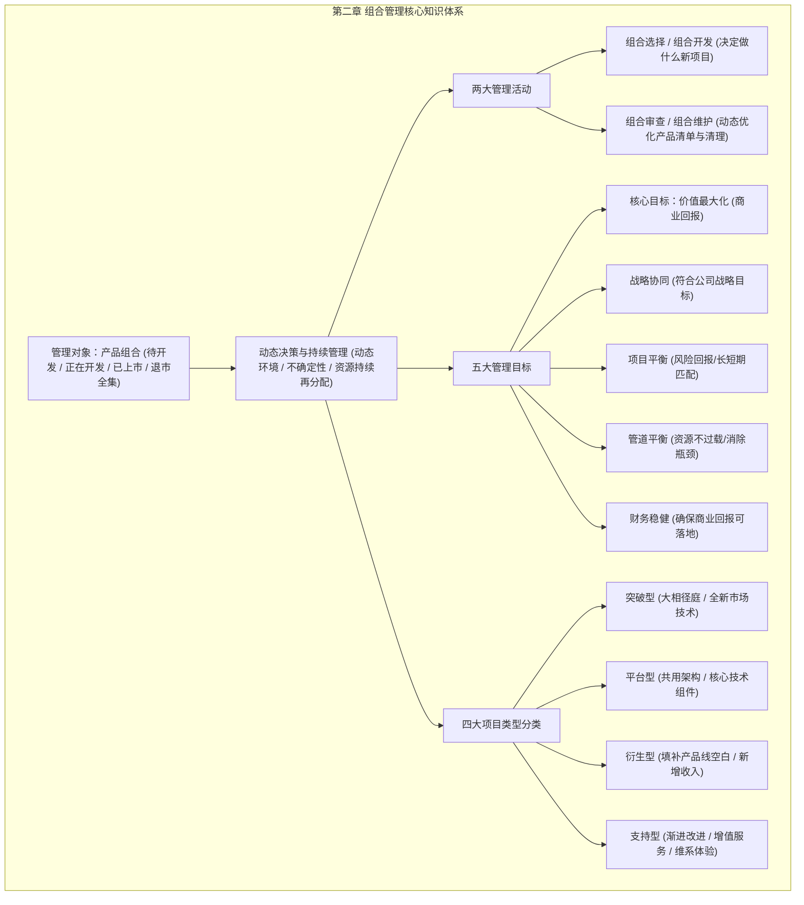
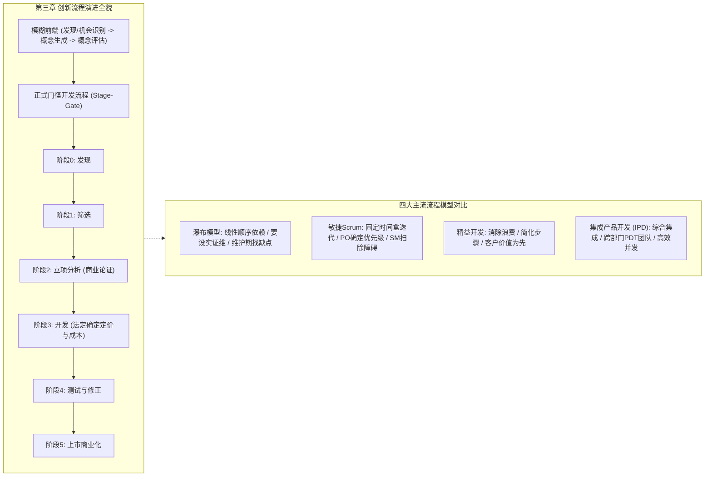

# NPDP期中模考大赛重难点讲解（下）：组合管理、流程与工具高频考点及错题精析

## 一、第二章“组合管理”核心知识体系系统串讲

### 1. 组合管理的定义与本质
- **管理对象是产品组合（Product Portfolio）**：
  - 产品组合是指组织通过战略性权衡与取舍所管理的一系列项目和产品；
  - 它不仅包含正在研发的项目，还囊括了**待开发的创意构想、开发中的在研项目、已上市销售的在市产品以及面临退市维护的老产品**全集；
  - **形象隐喻**：组合管理如同高考冲刺班的班主任，其核心职责不是只盯住某一两个尖子生，而是从全局统筹资源，想方设法让全班所有学生整体考上理想大学。
- **动态决策过程**：
  - 项目所处的外部市场环境瞬息万变，技术可行性存在高度不确定性，且所有研发投资都面向未来，无法在事前 100% 保证成功；
  - 组合管理必须是一个**动态、持续的决策过程**，定期对项目进行评估、选择、优先级排序与资源再分配。

### 2. 组合管理的两大活动与五大目标
- **两大核心活动**：
  1. **组合选择与开发（Portfolio Selection & Development）**：从众多潜在机会中挑选最具商业价值与战略匹配度的项目进入漏斗；
  2. **组合审查与维护（Portfolio Review & Maintenance）**：对已处于漏斗中的产品清单进行常态化审查，果断剔除丧失潜力的项目，动态释放受限资源。
- **五大管理目标（核心目标 + 四大分目标）**：
  - **核心目标：价值最大化（Maximize Value）**：确保投入的商业资本与有限资源换取最大的长期商业回报和企业价值；
  - **分目标 1：战略协同（Strategic Alignment）**：所有选定的项目必须直接服务于组织的战略目标与业务蓝图；
  - **分目标 2：项目平衡（Portfolio Balance）**：在项目类型（长期 vs 短期、高风险 vs 低风险、前沿突破 vs 衍生维护）上保持健康均衡，突出组织的战略偏好；
  - **分目标 3：管道平衡（Pipeline Balance）**：严格匹配组织资源供给（研发人力、资金、设备），确保资源不过载、管道不堵塞，以最精简的项目数量取得最大产出；
  - **分目标 4：财务稳健（Financial Health）**：确保组合项目具备可靠的财务回报率，兼顾当前盈利与未来现金流。

### 3. 创新漏斗模型与 Cooper 成功要素研究
- **创新漏斗模型（Innovation Funnel）**：
  - 前端汇聚了海量初始想法（新产品创意、工艺改进、技术预研、老产品维护支持）；
  - 通过层层关口评估与战略筛选，创意数量逐步收敛，资源集中投向最具成功概率的项目，直至最终上市商业化。
- **库珀（Robert G. Cooper）新产品上市成功要素研究**：
  - **首要成功因素：产品的优越性（Product Superiority）**！即具备独特优势、高性价比且切实解决用户痛点的卓越产品，这是商业成功的根基；
  - **第二成功因素：有吸引力的市场（Attractive Market）**（市场规模大、增长迅速、利润空间充裕、竞争格局良好）；
  - **第三成功因素：善于利用组织内部优势（Core Competencies）**（充分发挥企业自有的技术壁垒、渠道沉淀与核心竞争力）。

### 4. 研发项目四大类型深度辨析
| 项目类型 | 创新幅度与风险 | 核心题眼与特征 | 典型商业情境示例 |
| :--- | :--- | :--- | :--- |
| **突破型（Breakthrough）** | 极高风险、极高投资、高预期回报 | **与现有产品“大相径庭”**；运用新技术开拓全新业务赛道，颠覆既有模式 | 从传统燃油汽车跨越至纯电动自动驾驶汽车；胶卷摄影跨越至数码影像 |
| **平台型（Platform）** | 高投入、中高风险、长效复用 | **强调“共用架构（Shared Architecture）”**、核心技术底座与通用组件 | 苹果 A 系列芯片或 iOS 底层架构；汽车行业的模块化通用底盘平台 |
| **衍生型（Derivative）** | 中低风险、低投入、快速见效 | 基于平台或现有产品派生，**填补产品线与市场空白**，作为**新产品**带来新收入 | 基于既有自行车底盘换装新型材料车架；基于旗舰手机平台推出青春版/折叠屏版 |
| **支持型（Support）** | 最低风险、日常投入、改良性质 | **小幅渐进改进、修补缺陷（bug）**；制造工艺微调；针对老客户提供**增值维护服务**，**无全新独立产品特性** | 无人机厂商为已售机型开发配套的飞行数据管理软件；软件日常版本补丁 |

---

## 二、第三章“产品创新流程”核心知识体系系统串讲

### 1. 模糊前端（Fuzzy Front End, FFE）的本质与价值
- **模糊前端的定义**：进入正式产品开发阶段（Stage 3）之前的所有阶段（包括发现/机会识别、筛选/概念生成、立项分析/概念评估）统称为模糊前端。
- **为什么称为“模糊”前端？**：**因为在前端终结前，“产品的概念是模糊的”**！需求需要逐步界定，创意需要不断具象化，直到概念评估阶段结束产出明确的产品概念，模糊状态才告终止。
- **重视模糊前端的原因**：
  - 随着阶段逐步向后推进，变更成本呈指数级暴增，而不确定性则逐渐下降；
  - 在模糊前端早期投入充足资源进行审慎评估，变更代价极低，能够有效消除方向性错误，杜绝后期灾难性的巨额返工。

### 2. 产品创新章程（PIC, Product Innovation Charter）
- **文件性质**：是指导新产品开发全流程的**最高层级战略性指导文件**，是连接公司战略与执行落地的桥梁。
- **核心定位（回答五个 W，绝不回答 H）**：
  - 回答 **Who（谁来主导）、What（做什么产品）、Where（何处竞争）、When（何时上市）、Why（立项原因）**；
  - **绝不回答 How（怎么做）**！具体的技术细节、开发管理流程与操作方法属于执行层面，绝非战略性文件 PIC 的内容。
- **四大核心组成要素辨析（高频考点）**：
  1. **背景（Background）**：宏观行业与市场现状分析、立项核心动因、与经营战略的关系、**全行业关键技术的现状与未来发展趋势**；
  2. **重点舞台 / 聚焦领域（Focus Arena / 竞争焦点）**：**聚焦于企业具体锁定的“目标市场”**，以及**与目标市场密切相关的关键技术、营销渠道与特定竞争对手**；
  3. **目标和目的（Goals & Objectives）**：定量化的预期商业回报（如预期市场份额、营业收入、投资回报率）；
  4. **特别准则（Special Guidelines）**：项目的边界限制、汇报频率、团队授权、外部战略伙伴准入规则。

### 3. 门径管理流程（Stage-Gate）阶段法定交付
- **六阶段五关口规范演进**：
  - **阶段 0（发现）**：发现市场机会，生成大量初始创意；
  - **阶段 1（筛选）**：对创意进行初步案头评估，形成初步产品概念；
  - **阶段 2（立项分析 / 概念评估）**：深入开展市场调研、财务可行性测算与技术验证，输出详细的商业论证（Business Case）；
  - **阶段 3（开发阶段，高频错题点）**：**不仅完成物理产品的设计与原型试制，更是法定制定“上市规划（Launch Plan）”的阶段，具体的“产品定价与成本信息”必须在开发阶段最终确定**！
  - **阶段 4（测试与修正）**：不仅测试产品本身的性能缺陷，同时进行上市营销方案的实地测试；
  - **阶段 5（上市）**：全面规模化量产、全渠道铺货与商业变现。

### 4. 四大主流流程模型多维对比矩阵
1. **经典瀑布模型（Waterfall）**：
   - **核心特征**：线性顺序推进，严格依赖前序阶段产出。“要-设-实-证-维”（要求、设计、实施、验证、维护）；
   - **维护阶段的本质**：在产品交付后，**通过最终客户在实际使用中暴露并识别产品的缺陷与遗留问题**；阶段间不可逆，早期需求冻结，高低交替的互动频率。
2. **敏捷开发 Scrum 框架（Agile）**：
   - **核心特征**：以固定时间盒（Sprint，1~4周）进行高频增量迭代，强力拥抱变更；
   - **三大角色权责明晰**：
     - **产品负责人（Product Owner, PO）**：客户利益代言人，全权负责管理并调整产品代办事项列表（Product Backlog）的优先级顺序，决定是否验收团队交付的产品增量；
     - **敏捷教练（Scrum Master, SM）**：仆人式领导（Servant Leader），职责不是监控管理团队，而是为团队扫清开发障碍、提供环境支持，**与团队共同协商确定冲刺周期时长**；
     - **跨职能自组织团队（Team）**：通常 5~9 人（两个披萨原则），自我管理并全权负责当期冲刺增量的具体技术交付。
3. **精益产品开发（Lean Development）**：
   - **核心精髓**：以客户价值为唯一尺度，**彻底消除全流程的一切非增值浪费（Muda）**；简化交易链路、优化复杂步骤、减少等待与返工。
4. **集成产品开发（IPD, Integrated Product Development）**：
   - **核心精髓**：重在“综合集成”。以跨部门集成产品团队（PDT）为载体，吸纳门径、敏捷与精益的优点，追求有效和高效的并发工程开发；主要应用于复杂大型硬件、集团化企业（如华为、IBM）。

### 5. 流程治理（Governance）与管理（Management）的本质界限
- **治理（Governance）**：属于董事会与最高管理层的权责，建立决策框架、监督机制、准则与边界，关注“做什么、是否达成战略目标”；
- **管理（Management）**：属于执行层与项目负责人的权责，在治理设定的框架内行使日常经营权，运用具体技术与工具实现既定经营指标。

---

## 三、第二章与第三章高频错题（正确率 < 70%）逐题深度精析

### 【错题 1】组合管理中“整体性”的真正含义辨析（正确率极低）
> **题目情境**：新产品开发中的组合方法可以被称之为具有“整体性（Holistic）”。在这一语境下，“整体性”的准确含义是指：
> A. 对新产品在技术、市场与财务三个维度进行综合考察  
> B. 每一个新产品都必须适用于一个市场空白或利基市场  
> C. 将创新漏斗中的所有项目和产品作为一个整体来进行考察  
> D. 新产品开发的全过程，包括从战略指导直到新产品上市  

- **【题目考查场景与题眼】**：考查组合管理（Portfolio Management）的学科定义与基本视角。题眼在于“组合方法”语境下的“整体性”。
- **【核心考点还原】**：
  - 组合管理的核心使命，是对企业内部所有的在研、在市、待开发项目进行全盘战略性权衡，其管理对象是**处于漏斗中的所有项目构成的集合体（产品组合）**；
  - 必须将漏斗中的所有项目作为一个有机整体统筹评估其资源消耗、风险平衡与总价值产出（对应 C 选项）；
  - **D选项辨析**：D选项描述的是“单个新产品从创意到上市的全生命周期时间跨度”（属于单项目创新流程的完整性），而非“产品组合”的整体性。
- **【正确选项推导与易错干扰项辨析】**：
  - 正确答案为 **C**。
  - **易错归因**：大量学员混淆了“单产品流程生命周期的端到端”与“跨产品组合管理的全局整体性”，误选 D。班主任统筹全班是组合整体性，单个学生的成长是流程周期。

---

### 【错题 2】Cooper 总结的新产品上市成功首要因素
> **题目情境**：根据著名新产品管理学者库珀（Robert G. Cooper）关于“胜利者与失败者”的长期实证研究，决定新产品上市取得商业成功的首要因素是：
> A. 产品的优越性（独特且出色的产品）  
> B. 在项目早期阶段明确冻结产品的规格说明书  
> C. 发现极具吸引力的潜在市场机会  
> D. 卓越的营销执行与渠道推广绩效  

- **【题目考查场景与题眼】**：考查 PDMA 经典文献中关于新产品成败归因的核心结论。题眼在于“首要因素（Number One Factor）”。
- **【核心考点还原】**：
  - Cooper 在大量跨行业调研中总结了新产品成功的三大支柱：
    1. **首要因素（第一位）**：**产品的优越性（Product Superiority）**——唯有独特、高质量、能切实解决痛点的产品才是立足之本；
    2. **第二因素**：有吸引力的市场（容量大、增长快、利润高）；
    3. **第三因素**：善于利用组织内部的核心优势。
- **【正确选项推导与易错干扰项辨析】**：
  - 正确答案为 **A**。
  - **易错干扰项 C 辨析**：学员极易误选 C（市场机会）。虽然好的市场机会不可或缺，但若产品本身粗制滥造、缺乏核心竞争力，即便抢先占位也会迅速被竞争对手赶超淘汰。产品本身的优越性永远是第一基石。

---

### 【错题 3】改用新型材料制造自行车的项目类型归属题
> **题目情境**：某自行车制造企业多年来生产的产品与竞争对手大同小异，价格基本持平，市场竞争陷入胶着。不久前，该公司的产品研发经理寻找到一种全新的复合材料，不仅用其制造的车架轮毂更加结实耐用，而且原料采购成本显著降低。于是该公司基于该材料生产并上市销售了一种新型自行车。请问这种新型自行车属于哪种类型的项目？
> A. 突破型项目  
> B. 平台型项目  
> C. 衍生型项目  
> D. 支持型项目  

- **【题目考查场景与题眼】**：考查研发项目四大分类在实体制造业中的精准辨识。题眼为“基于新材料生产并上市销售了一种新型自行车产品”、“更结实且便宜”。
- **【核心考点还原】**：
  - **突破型**必须与现有产品“大相径庭”，开创全新业务形态（换了钛合金/复合材料依然是两轮自行车，不属于突破型，排除 A）；
  - **平台型**必须强调开发出了供一系列产品长期共用的底层通用架构（未提及通用底座架构，排除 B）；
  - **衍生型**基于现有产品或平台，引入新的特性改动，作为**独立的新型产品上市售卖**，旨在填补产品线空白、争夺增量市场份额并带来新收入，完全符合题意；
  - **支持型**通常仅为工艺微调、修补bug或老客户维护，不作为全新独立型号上市。
- **【正确选项推导与易错干扰项辨析】**：
  - 正确答案为 **C**。
  - **易错归因**：部分学员误选 A，认为“新材料”就是“突破”。NPDP 中的“突破型”门槛极高，必须带来产业形态的剧变；部分学员误选 D，忽略了该自行车是作为独立“新型号”面向市场销售创收的事实。

---

### 【错题 4】无人机厂商向已售客户提供数据管理软件的战略类型题
> **题目情境**：某商业无人机制造企业开始向其既有客户免费或低价提供一套专业的数据管理软件，专门用于管理与分析该公司此前出售给客户的每架无人机的实际飞行任务数据。该无人机公司所采取的产品战略属于：
> A. 突破型项目  
> B. 平台型项目  
> C. 衍生型项目  
> D. 支持型项目  

- **【题目考查场景与题眼】**：考查软硬件结合场景下产品类型的界定。题眼在于“向客户提供数据软件”、“管理已售无人机的飞行数据”。
- **【核心考点还原】**：
  - 核心服务对象是“既有老客户（已购买无人机的存量客户）”；
  - 推出软件的目的并非开辟独立的软件商业化产品线，而是为了完善硬件无人机的整体解决方案，提升老客户的使用体验与黏性，巩固既有硬件产品的市场壁垒；
  - 针对现有产品进行补充完善、提升用户体验的增值服务，属于典型的**支持型项目（Support Project）**。
- **【正确选项推导与易错干扰项辨析】**：
  - 正确答案为 **D**。
  - **易错干扰项 C 辨析**：很多学员看到“推出了软件”就当成衍生型新产品。关键要看该软件是否独立对外创收、拓展全新客群。本题中软件深度绑定已售硬件，本质是强化既有产品的支持性外围服务。

---

### 【错题 5】模糊前端之所以称为“模糊”的核心定义题
> **题目情境**：在新产品开发流程中，模糊前端（Fuzzy Front End）阶段之所以被称为“模糊”，其根本原因在于：
> A. 目标客户的需求尚未完全清晰界定  
> B. 潜在的市场规模存在高度不可预测性  
> C. 团队对所需技术的掌握程度尚不明确  
> D. 最终的产品概念是模糊的  

- **【题目考查场景与题眼】**：考查 PDMA 经典理论中模糊前端命名来源的权威定义。题眼为“之所以称为模糊是因为什么是模糊的”。
- **【核心考点还原】**：
  - 按照门径管理流程理论，模糊前端始于机会识别，终于正式立项开发决策（Gate 3）；
  - 在整个前端推进过程中，市场需求在不断被调研，技术可行性在不断被验证，而整个前端最终的法定终极交付成果是**清晰的产品概念（Product Concept）**；
  - **以终为始**：在进入开发阶段前，产品具体的形态、功能、架构尚未最终凝练成型，**核心在于“产品的概念（Product Concept）是模糊的”**。
- **【正确选项推导与易错干扰项辨析】**：
  - 正确答案为 **D**。
  - **易错归因**：大量学员凭常识直觉误选 A（需求模糊）。需求在初期确实模糊，但需求只是输入，整个前端的最终实体产出是概念。正是由于产品概念从混沌走向清晰，才决定了该阶段的本质特征。

---

### 【错题 6】关于产品创新章程（PIC）描述的错误项排查
> **题目情境**：关于新产品开发中的产品创新章程（PIC），以下描述中**错误**的是：
> A. 它是新产品开发项目成功实施的基础，建立在创新战略明确的方向之上  
> B. 它是一份关键的战略性文件，是推动新产品商业化过程的核心纽带  
> C. 它涵盖了项目的立项原因、目标目的、聚焦领域以及特别准则边界  
> D. 它详细回答了产品开发项目中谁来做、做什么、在哪里做、何时做以及具体怎么做  

- **【题目考查场景与题眼】**：考查产品创新章程（PIC）的内容边界与战略层级。题眼为“描述错误的是”。
- **【核心考点还原】**：
  - PIC 作为战略性宪章文件，回答 **Who、What、Where、When、Why**；
  - **PIC 绝不回答“具体怎么做（How）”**！具体的执行技术路线、每日排期、操作细则是项目执行计划的事情，战略文件绝不向下干预微观执行细节。
- **【正确选项推导与易错干扰项辨析】**：
  - 正确答案为 **D**（D 选项包含了“怎么做”，故表述错误，符合题意）。
  - A、B、C 均为官方教材关于 PIC 战略定位与四大构成要素的标准定义。

---

### 【错题 7】PIC 竞争焦点（聚焦领域 Focus Arena）的关键要素
> **题目情境**：在产品创新章程（PIC）的核心结构中，竞争焦点（即聚焦领域 Focus Arena）所包含的关键核心要素是：
> A. 明确的目标市场及与该市场密切相关的关键技术  
> B. 整个项目的总体范围与立项动因分析  
> C. 行业关键技术的当前发展现状与未来演化趋势  
> D. 项目对公司整体运营战略的量化商业贡献  

- **【题目考查场景与题眼】**：考查 PIC 四大要素中“背景”与“聚焦领域”的精细区分。题眼为“竞争焦点 / 聚焦领域（Focus Arena）”。
- **【核心考点还原】**：
  - **背景（Background）**：包含宏观项目范围、为什么做（立项动因），以及**全行业关键技术的现状与未来宏观趋势**（对应 B、C 选项）；
  - **聚焦领域（Focus Arena）**：**聚焦于企业即将展开竞争的“目标市场（Target Market）”**，以及**与该目标市场直接匹配的关键技术、营销渠道与竞争对手**（对应 A 选项）；
  - **目标与目的（Goals）**：量化的战略贡献指标（对应 D 选项）。
- **【正确选项推导与易错干扰项辨析】**：
  - 正确答案为 **A**。
  - **易错陷阱**：“关键技术”在背景与聚焦领域均有出现，必须区分：宏观行业技术现状与趋势属于“背景”，与自身目标市场紧密结合的具体技术应用属于“聚焦领域”。

---

### 【错题 8】新产品的具体定价与成本信息产生的法定阶段
> **题目情境**：在标准的门径管理流程（Stage-Gate）中，新产品的具体定价策略与最终成本核算信息，应当在以下哪一个阶段正式产生并明确？
> A. 机会识别阶段（发现阶段）  
> B. 概念评估阶段（立项分析阶段）  
> C. 开发阶段  
> D. 上市阶段  

- **【题目考查场景与题眼】**：考查门径流程各阶段的法定职责划分。题眼在于“具体的定价与成本信息正式产生”。
- **【核心考点还原】**：
  - 阶段 2（立项分析/商业论证）确实会进行财务预测，但彼时仅为基于假设的**粗略财务估算**；
  - 唯有进入**阶段 3（开发阶段）**，随着产品软硬件物理规格冻结、供应链物料BOM表明确，才能核算出精确的成本信息；同时，营销4P（产品、价格、渠道、促销）中的**最终定价策略**作为上市规划的法定产出，在**开发阶段**正式制定！
  - 阶段 4 需基于开发阶段确定的定价进行市场测试，故绝不能拖延到上市阶段（D 选项太晚）。
- **【正确选项推导与易错干扰项辨析】**：
  - 正确答案为 **C**。
  - **易错归因**：学员常凭实战中“立项时就要报预算”的经验误选 B。立项分析阶段只是提出财务假设，标准理论下精确成本核算与定价规划法定归属于开发阶段。

---

### 【错题 9】经典瀑布流程中“维护阶段”的本质特征描述
> **题目情境**：在经典的软件瀑布开发模型中，“维护阶段”最准确的本质描述是：
> A. 根据项目前期的架构设计编写实际底层代码  
> B. 组织跨部门评审以确保最终成果符合客户期望  
> C. 通过最终客户在实际使用中识别产品的缺点与遗留问题  
> D. 将客户需求转化为具体的物理软硬件设计说明书  

- **【题目考查场景与题眼】**：考查瀑布模型五大阶段（要-设-实-证-维）的本质定义。题眼为“维护阶段”。
- **【核心考点还原】**：
  - 瀑布模型在需求冻结后严格单向线性推进，直到交付验收；
  - “维护阶段（Maintenance）”并非单纯指售后客服，其在瀑布理论中的核心内涵在于：由于前期缺乏高频客户互动，**产品交付后最终只能依靠真实客户在实际生产环境中暴露并识别出未被发掘的产品缺陷与设计漏洞**。
- **【正确选项推导与易错干扰项辨析】**：
  - 正确答案为 **C**。
  - A 选项属于“实施阶段”，B 选项属于“验证阶段”，D 选项属于“设计阶段”。

---

### 【错题 10】敏捷 Scrum 框架中敏捷教练（Scrum Master）职责辨析
> **题目情境**：在敏捷开发 Scrum 框架中，关于敏捷教练（Scrum Master）的角色职责，以下描述中**错误**的是：
> A. 充当开发团队与产品主管（PO）之间的沟通协调者，积极为团队扫清外部障碍  
> B. 敏捷教练不直接插手开发细节，因此他不是冲刺周期（Sprint Duration）的决定人员  
> C. 激发团队的自组织创造力，主张对团队充分授权而非微观管理  
> D. 确保项目开发进展信息实时透明更新，对所有项目干系人保持可见  

- **【题目考查场景与题眼】**：考查敏捷三大角色中 Scrum Master 的核心权力边界。题眼为“描述错误的是”。
- **【核心考点还原】**：
  - Scrum Master 是典型的仆人式领导，不管理具体的代码或任务分配；
  - 但**在确定冲刺周期长度（如2周或3周）时，必须由敏捷教练与开发团队共同评估并决定**！敏捷教练要基于团队成熟度与风险频率提供专业指导，绝非局外人。故 B 选项声称“不是决定人员”截然错误。
- **【正确选项推导与易错干扰项辨析】**：
  - 正确答案为 **B**（B 选项表述错误，符合题意）。
  - A、C、D 均为敏捷教练的标准仆人式领导职责。

---

### 【错题 11】通过固定时间长度迭代交付的敏捷框架判断
> **题目情境**：某流程旨在通过一系列时间长度固定的迭代周期进行敏捷产品开发。该流程提供了一套完整的角色、仪式与工件框架，从而使开发团队能够以规律的节奏持续交付可运行的软件增量。该描述最精准对应的概念是：
> A. 冲刺（Sprint）  
> B. 精益（Lean）  
> C. 敏捷 Scrum 框架  
> D. 敏捷开发（Agile）  

- **【题目考查场景与题眼】**：考查敏捷具体方法与宏观概念的层级差异。题眼为“时间长度固定的迭代”、“提供了一套框架”、“有规律的节奏”。
- **【核心考点还原】**：
  - 题干明确指出这是一个“完整的流程框架”；
  - **Scrum 框架**以固定时间盒（Time-boxed Sprint）为标志，包含 PO/SM/Team 三大角色及规划会、站会、评审会、回顾会四大仪式；
  - **审题法则（问小选小）**：敏捷（Agile）是伞状宏观理念体系，旗下包含 Scrum、XP、看板等。题干特征已具体精确到了 Scrum 的全套框架，必须选具体的 **C（Scrum）** 而非泛指的 D。
- **【正确选项推导与易错干扰项辨析】**：
  - 正确答案为 **C**。
  - A 选项冲刺仅代表单个迭代周期，而非全套流程框架；B 选项精益核心是消除浪费，未强调固定冲刺框架。

---

### 【错题 12】瀑布方法与敏捷方法核心特征对比排查题
> **题目情境**：关于经典瀑布方法与敏捷方法的对比，以下哪项陈述**不包括在两者的实际差异之内**（即表述错误）：
> A. 瀑布方法由项目经理负责管理，而敏捷方法通常由流程管理员（Scrum Master）进行支持协调  
> B. 瀑布方法在发现问题时能够自由返回上一阶段，而敏捷方法则不允许返回上一阶段  
> C. 瀑布方法使用严格的顺序阶段（Stages），而敏捷方法使用时间盒迭代（Iterations）  
> D. 瀑布方法在项目周期内呈现高低不均的互动频率，而敏捷方法保持持续高频的业务互动  

- **【题目考查场景与题眼】**：考查瀑布与敏捷在阶段推进机制上的根本分水岭。题眼为“不包括在差异之内（哪项表述是假的）”。
- **【核心考点还原】**：
  - 瀑布模型强调阶段依赖与需求冻结，**一旦进入下一阶段严禁擅自退回上一阶段**（各阶段不可逆）；
  - 敏捷方法恰恰依靠短周期迭代拥抱变化，每个迭代结束都可根据评审反馈重新梳理待办事项，重新迭代上一轮的未尽增量；
  - B 选项颠倒黑白，将不可退回说成“自由返回”，故 B 选项错误，为本题正确答案。
- **【正确选项推导与易错干扰项辨析】**：
  - 正确答案为 **B**。
  - A、C、D 均准确揭示了瀑布与敏捷在角色机制、生命周期切分及客户沟通频率上的真实差异。

---

### 【错题 13】简化交易步骤以更好服务客户的流程模型判断
> **题目情境**：某家庭服务平台公司（Care.com）指定了一个跨职能团队，对现有的在线服务平台实施系统性创新任务。团队的主要工作内容包括：完善家庭护理基础服务体验、大幅简化在线预订与交易结算步骤、重构优化网页底层代码，并持续测试该创新平台是否能够更好地服务广大客户。最能够准确描述这一创新流程模型的选项是：
> A. 经典瀑布流程  
> B. 集成产品开发（IPD）  
> C. 门径管理流程（Stage-Gate）  
> D. 精益流程（Lean）  

- **【题目考查场景与题眼】**：考查精益思想在互联网与数字化服务优化中的落地表征。题眼在于“完善基础服务”、“大幅简化交易步骤”、“消除非增值环节”、“更好地服务客户”。
- **【核心考点还原】**：
  - **精益流程（Lean Process）的核心精髓是“消除一切非增值浪费，以客户价值为核心驱动降本增效”**；
  - 题干中“简化交易步骤”、“优化代码去除冗余流程”，本质上就是在消除用户交易路径上的摩擦与浪费，以最高效的路径向客户交付纯粹价值，属于典型的精益思想实践。
- **【正确选项推导与易错干扰项辨析】**：
  - 正确答案为 **D**。
  - **易错干扰项 B 辨析**：部分学员因看到“代码”而选瀑布，或看到“综合任务”而选 IPD。但题干未体现 IPD 的跨部门重量级团队并发开发，也未体现瀑布的线性需求冻结，最契合其微观优化动作本质的正是精益流程（消除浪费、简化流程）。

---

### 【错题 14】保障产品开发流程良好运作的最高层级要素
> **题目情境**：某企业建立了一套结构严密的产品开发流程，各职能部门在各个阶段均能够顺畅协同。然而从企业顶层设计的最高维度来看，能够持续保障产品开发流程运作良好并始终服务于公司长期价值的最关键顶层要素是：
> A. 持续开展高效的跨职能团队项目管理  
> B. 确保所有职能部门在日常开发流程中保持无障碍的横向沟通  
> C. 董事会与高管层对公司开发流程实施强有力的治理和监督（Governance）  
> D. 流程管理委员会对产品开发流程开展定期的复盘评审  

- **【题目考查场景与题眼】**：考查企业流程健康运行的最高控制层级。题眼为“顶层设计的最高维度”、“最关键顶层要素”。
- **【核心考点还原】**：
  - 流程治理（Governance）处于企业金字塔的顶端，是高层管理层和董事会确立的制度准则、决策机制与监督框架；
  - 项目管理、跨部门沟通及定期评审均属于微观层面的“管理活动”；唯有高层建立的**治理与监督机制（Governance & Oversight）**，才能确保整个流程始终对齐战略轨道，防止流程沦为形式主义或盲目推进错误项目。
- **【正确选项推导与易错干扰项辨析】**：
  - 正确答案为 **C**。
  - A、B、D 选项均属于治理框架约束下的具体管理执行行为，范围与层级均小于 C。遵循“问大选大”原则，最高层级保障唯有“治理与监督”。

---

## 四、第二章与第三章核心考点速查表（Cheat Sheet）

| 核心模块 | 考核核心概念 | 必背题眼与黄金特征 | 绝密避坑准则 |
| :--- | :--- | :--- | :--- |
| **组合管理本质** | 漏斗全局、动态管理、五大目标 | 针对所有产品（在研/在市/待开发）的**整体性**；核心目标**价值最大化** | 区分“组合整体性”（全漏斗项目群）与“流程完整性”（单产品端到端） |
| **四大项目类型** | 突破型、平台型、衍生型、支持型 | 突破型**大相径庭**；平台型**共用架构**；衍生型**填补空白新创收**；支持型**改良维护老客户** | 制造新型号卖钱算衍生型；换新材料不等于突破型；老产品数据软件算支持型 |
| **Cooper成功要素**| 优越产品、吸引力市场、内部优势 | **首要因素永远是产品的优越性**（独特高质解决痛点） | 见到好的市场机会不要抢选，没有优越产品作底座，市场再好也守不住 |
| **模糊前端 FFE** | 阶段构成与命名根由 | 始于机会终于Gate 3立项；**之所以模糊是因为产品概念模糊** | 模糊前端早期投入性价比极高，变更代价最低，能大幅消除后期灾难性返工 |
| **创新章程 PIC** | 战略文件、五W一H边界、四大要素 | 回答Who/What/Where/When/Why，**绝不回答How（怎么做）**；聚焦领域盯**目标市场** | 宏观全行业技术趋势归“背景”；自身目标市场的匹配技术与竞品归“聚焦领域” |
| **门径阶段法定产出**| 开发阶段（Stage 3）的核心产出 | 冻结规格、完成研发、**最终明确具体定价与成本信息、制定上市规划** | 定价与成本信息法定在开发阶段制定，立项分析仅做初步假设，上市做太晚 |
| **多流程模型选型**| 瀑布、敏捷Scrum、精益、IPD | 瀑布线性不可逆（维护期找缺点）；敏捷固定迭代（PO排序/SM扫除障碍）；**精益核心是消除浪费** | 简化步骤、去除冗余以服务客户优先选精益；只有明确强调多流程综合集成才选IPD |
| **流程治理 vs 管理**| 最高层级保障（治理与监督） | 治理管框架与目标（做什么）；管理管执行与技术（怎么做） | 题干询问保障流程长期健康的最高维度要素，毫不犹豫选择治理与监督（Governance） |
